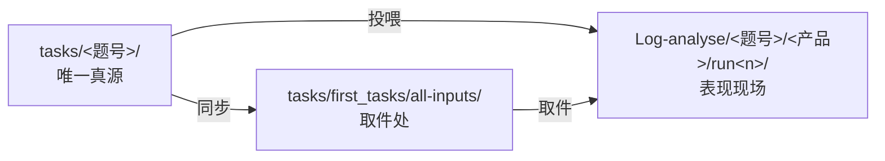

# harness-competitor-eval

五款 Agent 产品的 Harness 竞品评测（个人课题作业）

**评测对象**：Codex ｜ Workbuddy ｜ DSH ｜ 元宝专家模式 ｜ 豆包办公
**评测立场**：评 Harness（执行层），不评模型排行。所有结论可复核、每条判断标注证据等级（A 实测对照 / B 基线推断 / C 指纹复现）。

## 30 秒看懂

1. 读 [docs/01-评测方案-v1.md](docs/01-评测方案-v1.md)——评测问题、归因定责框架（模型/SKILL/Harness 三层证据链）、打分与复核机制
2. 读 [docs/02-题库骨架-v1.md](docs/02-题库骨架-v1.md)——**基线层** T01–T14 设计意图；**压力层 35 题**见 [docs/09](docs/09-执行层压力测试设计-v1.md) 与 [tasks/S-README.md](tasks/S-README.md)
3. 想复核？任意一题按 `tasks/` 四件套（任务书/初始文件/checker/规格）自行复现，`Log-analyse/` 是全部现场记录

## 目录导航（先看这张表）

| 目录 | 角色 | 关键说明 |
|---|---|---|
| `docs/` | **方法与规范** | 评测方案、题库骨架（基线层）、打分细则（`03` **v1 冻结**）、跑测手册、命名规范（`08`）、**压力测试设计（`09`）**、**归因与失败分类（`10`）**、**问题清单（`11`）** |
| `tasks/<批次>/<题号>/` | **唯一真源** | 每题四件套：`task.md`（不投喂）· `prompt.txt`（投喂指令原文）· `inputs/`（投喂附件）· `checker.py` · `spec.md`，另加可选 `truth.json` / `判分记录表.md` |
| `tasks/first_tasks/all-inputs/` | **取件处（副本）** | 全部投喂文件的扁平取件副本，**从真源同步，勿在此编辑**；投喂前必读其 `README.md` |
| `Log-analyse/` | **表现现场** | `Log-analyse/<题号>/<产品>/run<n>/`：`timeline.md` + `session.log` + `artifacts/` + `shots/` + `recording.txt` |
| `Log-analyse/Five-app-log-analyse/` | 补充现场 | 五款日志分析批，**不走** `<题号>/<产品>/run<n>` 格式，直接按 `<产品>-log-analyse/` 组织 |
| `Log-analyse/baseline/` | **基线 + 回滚包** | 冻结操作指引；`_backup/` 是评测期移走的个人技能（回滚用，**非现场记录**，不入 git）|
| `scripts/` | 辅助脚本 | 脚手架、用例生成、快照归档、判分汇总 |
| `docs/周报/` | **周报留档** | 每周周报的 markdown 版，与邮件发送版一致 |
| `CHANGELOG.md` | **变更日志** | 按日期记录实质性变更（方案/题库/脚本/文档）；每次实质提交同步登记 |
| `_archive/` | **整理前快照** | 历史整理前的副本留档，不入 git（见其 `README.md` 的路径迁移记录）|

## 投喂一句话口诀

> **附件只挂 `inputs/` 里的数据文件；指令只粘贴 `prompt.txt` 的正文；`task.md`/`spec.md`/`truth.json`/`checker.py` 绝不投喂。**

详细对照表见 [`tasks/first_tasks/all-inputs/README.md`](tasks/first_tasks/all-inputs/README.md)。

## 状态（2026-10-20）

**已完成**

- [x] 评测方案 v1（2026-10-10）
- [x] 打分细则 **v1 冻结**（[docs/03](docs/03-打分细则-v1.md)，2026-10-17；此后只走 §9 登记制修订）
- [x] 基线层题库 **T01–T14** 四件套 + checker
- [x] **S 压力层 35 题**（`tasks/second_tasks/S01–S35`：deep-12 + light-23）——35/35 负控制独立复核通过
- [x] 失败分类与归因体系 v1（[docs/10](docs/10-执行层归因与失败分类-v1.md)：两轴失败表 + BadCase→三句话 判定卡）
- [x] S 批跑测脚手架与结果大表骨架（[scripts/sbatch.py](scripts/sbatch.py)、[Log-analyse/S-batch/](Log-analyse/S-batch/)）
- [x] 仓库维护机制：变更日志 [CHANGELOG.md](CHANGELOG.md)、周报留档 [docs/周报/](docs/周报/)

**进行中 / 待做**

- [ ] 阶段 3 · 批量跑测：深跑批 12 题 × 5 款优先 —— **脚手架就绪，尚无真实运行记录**
- [ ] 阶段 4 · 逐格判分 → 单题分 / 维度剖面 / 总分
- [ ] 阶段 5 · 归因闭环：裸模型探针 → DSH 换件 → 复测
- [ ] 阶段 6 · 评测报告

> 周报每周六更新，留档于 [`docs/周报/`](docs/周报/)；实质性变更同步登记在 [`CHANGELOG.md`](CHANGELOG.md)。
