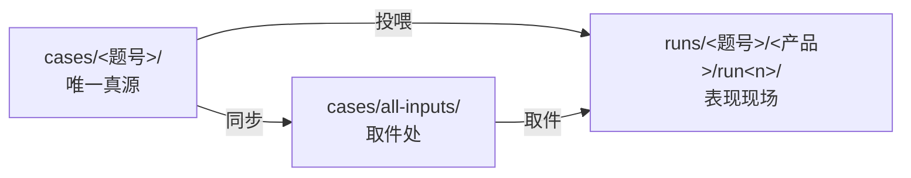

# harness-competitor-eval

五款 Agent 产品的 Harness 竞品评测（个人课题作业）

**评测对象**：Codex ｜ Workbuddy ｜ DSH ｜ 元宝专家模式 ｜ 豆包办公
**评测立场**：评 Harness（执行层），不评模型排行。所有结论可复核、每条判断标注证据等级（A 实测对照 / B 基线推断 / C 指纹复现）。

## 30 秒看懂

1. 读 [docs/01-评测方案-v1.md](docs/01-评测方案-v1.md)——评测问题、归因定责框架（模型/SKILL/Harness 三层证据链）、打分与复核机制
2. 读 [docs/02-题库骨架-v1.md](docs/02-题库骨架-v1.md)——14 题设计意图 + 七维度 × 五任务类型覆盖矩阵
3. 想复核？任意一题按 `cases/` 四件套（任务书/初始文件/checker/规格）自行复现，`runs/` 是全部现场记录

## 目录导航（先看这张表）

| 目录 | 角色 | 关键说明 |
|---|---|---|
| `docs/` | **方法与规范** | 评测方案、题库骨架、打分细则、跑测手册、命名规范（`08`）|
| `cases/<题号>/` | **唯一真源** | 每题四件套：`task.md`（不投喂）· `prompt.txt`（投喂指令原文）· `inputs/`（投喂附件）· `checker.py` · `spec.md`，另加可选 `truth.json` / `判分记录表.md` |
| `cases/all-inputs/` | **取件处（副本）** | 全部投喂文件的扁平取件副本，**从真源同步，勿在此编辑**；投喂前必读其 `README.md` |
| `runs/` | **表现现场** | `runs/<题号>/<产品>/run<n>/`：`timeline.md` + `session.log` + `artifacts/` + `shots/` + `recording.txt` |
| `runs/Five-app-log-analyse/` | 补充现场 | 五款日志分析批，**不走** `<题号>/<产品>/run<n>` 格式，直接按 `<产品>-log-analyse/` 组织 |
| `runs/baseline/` | **基线 + 回滚包** | 冻结操作指引；`_backup/` 是评测期移走的个人技能（回滚用，**非现场记录**，不入 git）|
| `scripts/` | 辅助脚本 | 脚手架、用例生成、快照归档、判分汇总 |
| `_archive/` | **整理前快照** | 历史整理前的副本留档，不入 git（见其 `README.md` 的路径迁移记录）|

## 投喂一句话口诀

> **附件只挂 `inputs/` 里的数据文件；指令只粘贴 `prompt.txt` 的正文；`task.md`/`spec.md`/`truth.json`/`checker.py` 绝不投喂。**

详细对照表见 [`cases/all-inputs/README.md`](cases/all-inputs/README.md)。

## 状态

- [x] 评测方案 v1（2026-10-10）
- [x] 题库骨架 v1：14 题 + 覆盖矩阵
- [ ] W2-3：题库四件套 + checker + 打分细则 v1
- [ ] W4-7：主跑批 70 次
- [ ] W9：DSH 换件对照实验
- [ ] W10（12 月中）：报告 + 冻结

进度周报每周六更新。
