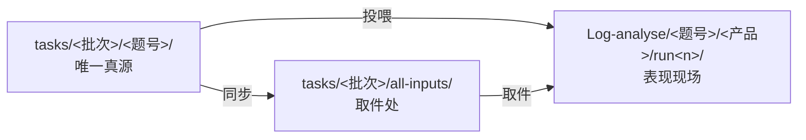

# harness-competitor-eval

五款 Agent 产品的 Harness 竞品评测（个人课题作业）

**评测对象**：Codex ｜ Workbuddy ｜ DSH ｜ 元宝专家模式 ｜ 豆包办公
**评测立场**：评 Harness（执行层），不评模型排行。所有结论可复核、每条判断标注证据等级（A 实测对照 / B 基线推断 / C 指纹复现）。

## 30 秒看懂

1. 读 [docs/01-评测方案-v1.md](docs/01-评测方案-v1.md)——评测问题、归因定责框架（模型/SKILL/Harness 三层证据链）、打分与复核机制
2. 读 [docs/02-题库骨架-v1.md](docs/02-题库骨架-v1.md)——**基线层** T01–T14 设计意图；**压力层 35 题**见 [docs/09](docs/09-执行层压力测试设计-v1.md) 与 [tasks/S-README.md](tasks/S-README.md)
3. 想复核？任意一题按 `tasks/<批次>/<题号>/` 四件套（任务书/初始文件/checker/规格）自行复现，`Log-analyse/` 是全部现场记录

## 目录导航（先看这张表）

| 目录 | 角色 | 关键说明 |
|---|---|---|
| `docs/` | **方法与规范** | 评测方案、题库骨架（基线层）、打分细则（`03` **v1 冻结**）、跑测手册、命名规范（`08`）、**压力测试设计（`09`）**、**归因与失败分类（`10`）**、**问题清单（`11`）**、**tau2 借鉴与改造方案（`13` 讨论稿）**、**chapter7 评估体系实施细化（`14` 讨论稿）**、**S06 试点运行卡（`15`）**、**dsh 三篇文档精读（`16`，评测视角）**、**导师验收口径核对与下一轮调整（`17`）**、**未知登记表（`18`）**、**dsh 原始日志取数手册（`20`，工具调用 + 七维度）**、**阶段报告（`docs/reports/`）** |
| `benchmarks/` | **评测 frame** | `harness-v1-pilot.json`（五款 × S06 × 1 trial）+ `pins.json`（题包哈希）；试点结果不作排名 |
| `products/` | **产品基线** | `products.json`：五款版本/账号/配置一次填；`prepare` 自动带入 `run.json.binding` |
| `tasks/<批次>/<题号>/` | **唯一真源** | 每题四件套：`task.md`（不投喂）· `prompt.txt`（投喂指令原文）· `inputs/`（投喂附件）· `checker.py` · `spec.md`，另加可选 `truth.json` / `判分记录表.md` |
| `tasks/<批次>/all-inputs/` | **取件处（副本）** | 全部投喂文件的扁平取件副本，**从真源同步，勿在此编辑**；投喂前必读其 `README.md` |
| `Log-analyse/` | **表现现场** | `Log-analyse/<题号>/<产品>/run<n>/`：`timeline.md` + `session.log` + `artifacts/` + `shots/` + `recording.txt` + 证据三件套（`manifest/usage/score.json`） |
| `Log-analyse/<产品>-log-analyse/` | 补充现场 | 五款日志分析批，**不走** `<题号>/<产品>/run<n>` 格式，直接按产品目录组织 |
| `Log-analyse/baseline/` | **基线 + 回滚包** | 冻结操作指引；`_backup/` 是评测期移走的个人技能（回滚用，**非现场记录**，不入 git）|
| `scripts/` | 辅助脚本 | 脚手架、用例生成、快照归档、判分汇总；**`dsh_export.py`** 导出 dsh 原始会话日志的工具调用与七维度信号 |
| `docs/周报/` | **周报留档** | 每周周报的 markdown 版，与邮件发送版一致 |
| `CHANGELOG.md` | **变更日志** | 按日期记录实质性变更（方案/题库/脚本/文档）；每次实质提交同步登记 |
| `_archive/` | **整理前快照** | 历史整理前的副本留档，不入 git（见其 `README.md` 的路径迁移记录）|

## 投喂一句话口诀

> **附件只挂 `inputs/` 里的数据文件；指令只粘贴 `prompt.txt` 的正文；`task.md`/`spec.md`/`truth.json`/`checker.py` 绝不投喂。**

详细对照表见 [`tasks/first_tasks/all-inputs/README.md`](tasks/first_tasks/all-inputs/README.md) 与 [`tasks/second_tasks/all-inputs/README.md`](tasks/second_tasks/all-inputs/README.md)。

## 状态（2026-10-25）

**已完成**

- [x] 评测方案 v1（2026-10-10）
- [x] 打分细则 **v1 冻结**（[docs/03](docs/03-打分细则-v1.md)，2026-10-17；此后只走 §9 登记制修订）
- [x] 基线层题库 **T01–T14** 四件套 + checker
- [x] **S 压力层 35 题**（`tasks/second_tasks/S01–S35`：deep-12 + light-23）——35/35 负控制独立复核通过
- [x] 失败分类与归因体系 v1（[docs/10](docs/10-执行层归因与失败分类-v1.md)：两轴失败表 + BadCase→三句话 判定卡）
- [x] S 批跑测脚手架与结果大表（[scripts/sbatch.py](scripts/sbatch.py)、[Log-analyse/S-batch/](Log-analyse/S-batch/)）
- [x] 任务卡与运行证据规范（[docs/08 §8](docs/08-目录与命名规范.md)，2026-10-22）：YAML 头 + 证据三件套 + "形态不支持"口径
- [x] **S06 单题试点 5/5**（五款各 1 次；产物分与行为分均已签认，证据等级 C）——[pilot-summary](Log-analyse/S-batch/S06-artifact-deep-path/pilot-summary.md)
- [x] **K1、K2、K3 判卷漏洞已修复**（S13 篡改 B 行 3.5→0.5；S17 漏总计行 7.0→6.0；S31 缺失写成 `0` 仍满分 7.0→6.0、同义表述被误杀 6.0→7.0；[KNOWN_ISSUES](tests/KNOWN_ISSUES.md)）
- [x] **T02 原因验证已结清**（判真值错、非 Harness，证据等级 B；[阶段报告 §5](docs/reports/阶段报告-01-2026-10-24.md)）
- [x] **U-05 裸模型探针已跑**（S06 × 2 次，均 7.0/7 且输出逐字相同；[探针现场](Log-analyse/probes/U-05-deepseek/S06/summary.md)）
- [x] **周报 02 已出**（运行账 5/5/0/0 + 现场链接 + 3 项可验收目标；[周报02](docs/周报/周报02-2026-10-23.md)）
- [x] **未知登记表**（[docs/18](docs/18-未知登记表.md)：3 条开放 + 6 条已结清，均带下一步与停止条件）
- [x] 仓库维护机制：变更日志 [CHANGELOG.md](CHANGELOG.md)、周报留档 [docs/周报/](docs/周报/)

**进行中 / 待做**

- [ ] 评测框架 v2：tau2 式 manifest/pin + 双轨成功口径 —— **讨论稿已出，待拍板**（[docs/13](docs/13-tau2借鉴与评测改造方案-v0.1.md)）
- [ ] 评估体系 v2：chapter7 四环节 + Rubric v2 + 首错归因 + 轨迹前缀回归 —— **讨论稿已出，待拍板**（[docs/14](docs/14-Agent评估体系借鉴与实施细化-v0.1.md)）
- [ ] 阶段 3 · 批量跑测：深跑批 12 题 × 5 款 —— **S06 单题试点已完成，全批尚未开始**
- [ ] 阶段 4 · 全量逐格判分 → 单题分 / 维度剖面 / 总分 —— **S06 五款行为分已签认**
- [ ] 阶段 5 · 归因闭环：裸模型探针 → DSH 换件（最低 3 件 × 2 题 × 2 次，见 [docs/09 §5.3](docs/09-执行层压力测试设计-v1.md)）→ 复测 —— **T02 已结清（B）；U-05 探针 2/2 已跑；DSH 换件仍为 0**
- [ ] 阶段 6 · 评测报告

> 周报每周六更新，留档于 [`docs/周报/`](docs/周报/)；实质性变更同步登记在 [`CHANGELOG.md`](CHANGELOG.md)。
