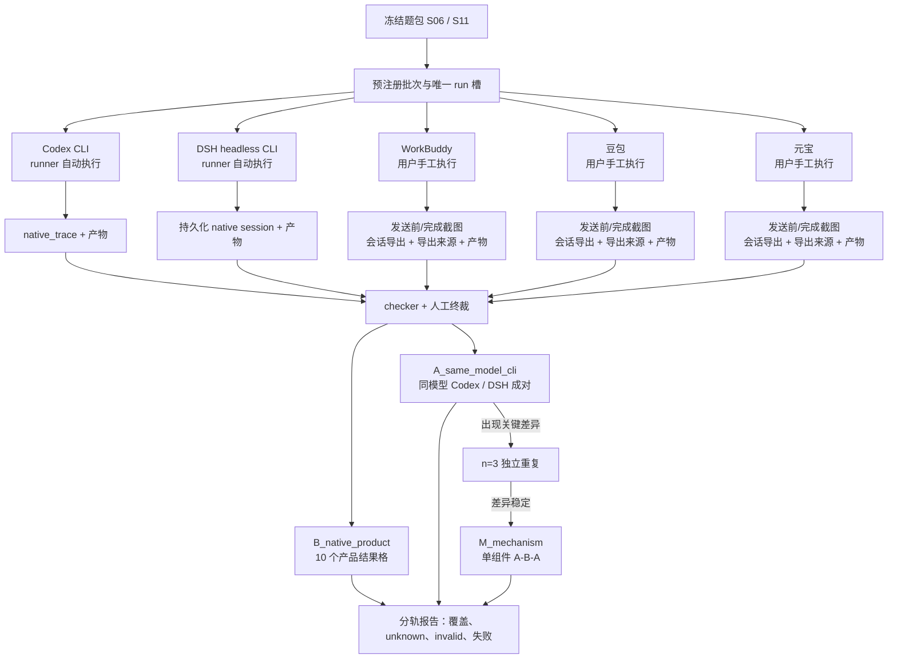

# v3 执行与覆盖路线图（2026-11-07）

> 当前状态：Codex CLI `0.166.0`、DSH CLI `0.2.2-rc.1` 已固定并通过整批预检；尚未调用模型、尚未创建新的产品运行。下一步先完成 10 个核心产品格，再启动 Harness 因果对照。

## 协作拓扑

## 你与 Codex 的责任边界

| 环节 | Codex 自动完成 | 你需要完成 |
|---|---|---|
| CLI 环境 | 版本预检、独立工作区、唯一 run、隔离 Codex home、启动 Codex/DSH | 确认允许使用的模型账号与预算；若认证失效则重新登录 |
| Codex/DSH 运行 | 批量执行 S06/S11、保存原生日志、stdout/stderr、cwd、产物和哈希 | 开跑前确认本批模型/推理档位；遇到账户确认或付费提示时处理 |
| 桌面三款 | 生成 prepare/collect/adjudicate 命令，检查你交回的证据完整性 | 新会话手工投喂 WorkBuddy/豆包/元宝；保存发送前截图、完成截图、原始会话导出、导出来源和产物 |
| 判卷 | 运行 checker、生成准入表和覆盖报告、标出缺口 | 对行为格与不可见部分做人工确认；真实失败/unknown/invalid 不改写成成功 |
| Harness 归因 | 校验控制合同、运行时模型和权限、合同哈希、同题配对 | 确认 DSH 与 Codex 可使用同一 OpenAI provider/model；签署配置快照的实际含义 |
| 发布 | 更新报告、证据索引、PR 和变更记录 | 审阅最窄结论；决定是否进行 n=3 重复或机制换件 |

## 主路线与停止线

### 阶段 1：核心执行覆盖

目标是 `S06 + S11 × 5 产品 = 10 格`。Codex/DSH 四格由 runner 自动跑，WorkBuddy/豆包/元宝六格手工跑。每格只要求形成可审计的 `pass/fail/unknown/invalid`，不要求全部成功。

完成条件：10 格都有唯一身份和终裁；桌面场都有 `desktop_export` 四项证据；CLI 场都有原生 session；覆盖报告不再把历史记录数当正式覆盖数。

### 阶段 2：同模型 Harness 对照

只比较 Codex CLI 与 DSH CLI。先确认双方能调用同一 `openai` provider、同一 model、同一 reasoning、provider 默认 sampling、同一外部环境和权限；Skills/Memory 关闭。工具、system prompt 和编排允许不同，它们共同构成 Harness treatment。

先跑 S06/S11 各一对。若没有关键差异，停止扩样并报告“本条件下未观察到差异”；若有可能改变判断的差异，再预注册每侧 `n=3` 独立重复。

### 阶段 3：机制归因

只有阶段 2 的差异在独立重复中保持，才进入 `M_mechanism`。每次只改变一个 Harness 组件，并优先使用 A-B-A：基线 → 换件 → 恢复。Skill on/off 只能归因到该 Skill；工具、权限或停止策略换件只能归因到对应组件。

### 阶段 4：扩题与最终报告

S06/S11 闭环后，才按已观察到的失败机制从 35 题中增加 1–2 题。最终报告分列：产品结果、执行行为、正式覆盖、unknown/invalid、Harness 因果、组件机制，不输出跨模型总排名。

## 下一次协作顺序

1. 你确认第一批 CLI 使用“各产品默认模型的 B 轨”，还是先提供 Codex/DSH 可共同调用的 OpenAI model 做 A 轨。
2. Codex 运行 `core-cli-v3` 四个自动格并归档，遇到认证/额度界面时停下交给你处理。
3. Codex 为 WorkBuddy、豆包、元宝分别生成六张桌面运行卡；你逐场执行并把证据路径交回。
4. Codex 收件、checker、生成缺口表；你只复核行为格和不可见边界。
5. 完成 10 格后再决定是否启动同模型 `n=3` 或机制 A-B-A，不提前扩到 35 题。
